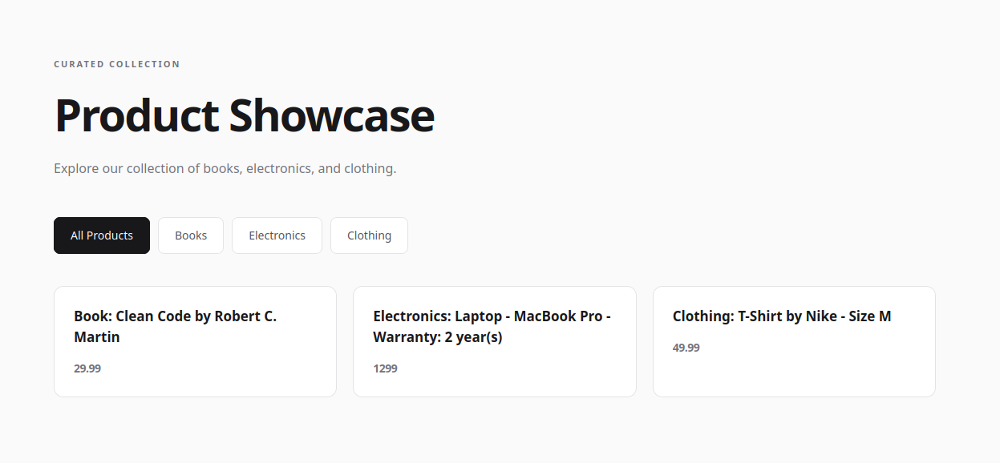

# 🛍️ Product Showcase

### Explore Products with TypeScript

A modern, responsive product catalog built with **TypeScript, Vite, HTML5, and CSS3**.

Product Showcase allows users to browse a curated collection of books, electronics, and clothing, dynamically filter products by category, and explore product information through a clean, minimalist interface.

The project demonstrates practical TypeScript development, generic classes, interface inheritance, discriminated unions, type narrowing, event delegation, and dynamic DOM manipulation.

**Built as part of the freeCodeCamp TypeScript curriculum.**

---

## 📸 Preview



A responsive product catalog featuring dynamic product cards, category-based filtering, and a clean, modern interface.

---

## ✨ Features

- 🛍️ **Product Catalog** — Browse a collection of books, electronics, and clothing.
- 🔎 **Category Filtering** — Instantly filter products without reloading the page.
- ⚡ **Dynamic Rendering** — Generate product cards dynamically using TypeScript.
- 🎯 **Active Category Highlighting** — Visually identify the currently selected category.
- 🧩 **Generic Collection** — Manage product data using a reusable `Collection<T>` class.
- 🛡️ **Type Safety** — Enforce product structures through TypeScript interfaces and union types.
- 🔄 **Event Delegation** — Handle category selection using a single event listener.
- 🎨 **Responsive Design** — Optimized layouts for desktop, tablet, and mobile devices.
- 🏗️ **Modular Architecture** — Separate product types, data, rendering, and application logic.
- 🚀 **Containerized Development** — Powered by Vite, Docker, and Nginx.

---

## 🛠️ Tech Stack

| Technology | Purpose |
|---|---|
| TypeScript | Application logic and static typing |
| JavaScript (ES6+) | Modern JavaScript functionality |
| Vite | Development server and production bundling |
| HTML5 | Semantic page structure |
| CSS3 | Responsive layouts and styling |
| Node.js | JavaScript development environment |
| Yarn | Package management |
| Docker | Containerized development |
| Docker Compose | Multi-container orchestration |
| Nginx | Web server and reverse proxy |
| Make | Development workflow automation |
| Git | Version control |

---

## 🚀 Getting Started

The project includes a Docker-based development environment for consistent setup across different machines.

### Prerequisites

Make sure the following tools are installed:

- Docker
- Docker Compose
- Make
- Git

### Installation

**1. Clone the repository**

```bash
git clone git@github.com:djimgon/product-showcase.git
cd product-showcase
```

**2. Initialize the development environment**

```bash
make init
```

This command initializes the Docker-based development environment, builds the required containers, and installs frontend dependencies.

**3. Open the application**

Once the containers are running, visit:

**http://localhost:8080**

### Stop the Application

To stop the containers, run:

```bash
make down
```

---

## 🏗️ Project Architecture

The application follows a lightweight, modular architecture using TypeScript.

Each module has a clearly defined responsibility, improving maintainability, readability, and code reusability.

### Product Data Model

Product information is described through a base interface and specialized interfaces using inheritance.

```typescript
interface Item {
    type: 'book' | 'electronics' | 'clothing';
    id: string;
    price: number;
}

interface Book extends Item {
    type: 'book';
    title: string;
    author: string;
}

interface Electronics extends Item {
    type: 'electronics';
    item: string;
    model: string;
    warranty?: number;
}

interface Clothing extends Item {
    type: 'clothing';
    item: string;
    brand: string;
    size?: 'S' | 'M' | 'L';
}

type Product = Book | Electronics | Clothing;
```

The `Product` union type ensures that every product conforms to one of the supported product categories.

Optional properties allow products to contain additional information without requiring every field.

### Generic Collection

The application implements a reusable generic class for managing collections of strongly typed objects.

```typescript
export class Collection<T> {
    constructor(public items: T[]) {}

    getAll(): T[] {
        return this.items;
    }

    filter(callback: (item: T) => boolean): T[] {
        return this.items.filter(callback);
    }
}
```

The generic type parameter `<T>` allows the collection to work with different data types while maintaining compile-time type safety.

The application creates a product collection using:

```typescript
const products = new Collection<Product>(productsData);
```

This approach separates data storage from product-specific application logic.

### Type Narrowing & Product Rendering

Product cards are generated dynamically using discriminated unions and TypeScript type narrowing.

```typescript
export function renderProduct(product: Product): string {
    let description: string;

    switch (product.type) {
        case 'book':
            description = `Book: ${product.title} by ${product.author}`;
            break;

        case 'electronics':
            description = `Electronics: ${product.item} - ${product.model}`;

            if (product.warranty !== undefined) {
                description += ` - Warranty: ${product.warranty} year(s)`;
            }
            break;

        case 'clothing':
            description = `Clothing: ${product.item} by ${product.brand}`;

            if (product.size !== undefined) {
                description += ` - Size ${product.size}`;
            }
            break;

        default:
            throw new Error(
                `Unknown product type: ${JSON.stringify(product)}`
            );
    }

    return `
        <div class="item" id="${product.id}">
            <h3>${description}</h3>
            <p class="price">${product.price}</p>
        </div>
    `;
}
```

The `switch` statement narrows the `Product` union to the appropriate interface based on the `type` property.

This enables safe access to category-specific fields without explicit type assertions.

The HTML card structure is defined once, avoiding duplicated markup.

### Category Filtering

Products are filtered using the generic collection's `filter()` method.

```typescript
const filteredProducts = type
    ? products.filter(product => product.type === type)
    : products.getAll();
```

When a category is selected, only matching products are displayed.

When no category is specified, the complete collection is returned.

### Dynamic DOM Rendering

The application transforms product objects into HTML strings using `map()` and `join()`.

```typescript
output.innerHTML = filteredProducts
    .map(renderProduct)
    .join('');
```

This approach enables dynamic updates without reloading the page.

### Event Delegation

Instead of attaching separate event listeners to every category button, the application uses event delegation.

```typescript
const categoryMap: Record<string, Product['type'] | undefined> = {
    all: undefined,
    books: 'book',
    electronics: 'electronics',
    clothing: 'clothing'
};

const buttons = document.querySelector('.buttons');

buttons?.addEventListener('click', (event) => {
    const target = event.target;

    if (!(target instanceof HTMLButtonElement)) {
        return;
    }

    if (!Object.hasOwn(categoryMap, target.id)) {
        return;
    }

    showProducts(categoryMap[target.id]);
    setActiveButton(target.id);
});
```

A single event listener manages all category buttons.

This reduces duplicated code and simplifies future maintenance.

### Application Initialization

The application separates initialization logic from the main entry point.

```typescript
import './style.css';
import { initApp } from './app';

document.addEventListener('DOMContentLoaded', initApp);
```

The `initApp()` function initializes product rendering and registers event listeners after the HTML document has been parsed.

---

## 🧠 TypeScript Concepts Practiced

This project provides hands-on experience with fundamental and intermediate TypeScript concepts.

### Type System

- Interfaces
- Interface inheritance (`extends`)
- Type aliases
- Union types
- String literal types
- Optional properties
- Generic types (`<T>`)
- Indexed access types
- Utility types (`Record<K, V>`)
- Discriminated unions
- Type narrowing
- Explicit return types

### Object-Oriented Programming

- Classes and instances
- Constructors
- Public properties
- Generic classes
- Class methods
- The `this` keyword
- Reusable data structures

### Functional Programming

- Callback functions
- Arrow functions
- Array filtering
- Array mapping
- Function composition
- Higher-order functions

### DOM & JavaScript

- DOM manipulation
- Event listeners
- Event delegation
- Event bubbling
- `DOMContentLoaded`
- `querySelector()`
- `querySelectorAll()`
- `innerHTML`
- `classList.toggle()`
- Optional chaining (`?.`)
- Template literals
- Dynamic HTML generation

### Software Architecture

- ES modules
- Import and export
- Type-only imports
- Separation of concerns
- Modular application structure
- Reusable components
- DRY (Don't Repeat Yourself)

---

## 📁 Project Structure

```text
product-showcase/
├── docs/
│   └── screenshots/
│       └── product-showcase.png
│
├── frontend/
│   ├── docker/
│   │   └── development/
│   │       ├── nginx/
│   │       └── node/
│   │
│   ├── public/
│   │
│   ├── src/
│   │   ├── components/
│   │   │   └── ProductCard.ts
│   │   │
│   │   ├── data/
│   │   │   └── products.ts
│   │   │
│   │   ├── models/
│   │   │   └── Collection.ts
│   │   │
│   │   ├── types/
│   │   │   └── product.ts
│   │   │
│   │   ├── app.ts
│   │   ├── main.ts
│   │   └── style.css
│   │
│   ├── index.html
│   ├── package.json
│   ├── tsconfig.json
│   └── yarn.lock
│
├── gateway/
│   └── docker/
│       └── development/
│           └── nginx/
│
├── docker-compose.yml
├── Makefile
├── README.md
└── LICENSE
```

The application follows a modular structure where each module is responsible for a specific part of the system.

This organization keeps the main entry point lightweight and makes the codebase easier to maintain and extend.

---

## 📱 Responsive Design

The interface adapts to different screen sizes using CSS Grid, Flexbox, and media queries.

| Device | Layout |
|---|---|
| Desktop | Three-column product grid |
| Tablet | Two-column product grid |
| Mobile | Single-column product grid |

The design uses a minimal visual style with neutral colors, subtle borders, rounded cards, and interactive category buttons.

---

## 🧪 Testing & Validation

The project was developed according to the freeCodeCamp **Build a Product Showcase** laboratory requirements.

**All 43 freeCodeCamp laboratory tests passed.**

The tests cover:

- TypeScript interfaces and inheritance.
- Literal types and optional properties.
- Product union types.
- Generic class implementation.
- Collection filtering.
- Product-specific HTML generation.
- Type narrowing.
- Error handling for unknown product types.
- Product collection initialization.
- Dynamic DOM rendering.
- Category filtering.
- Event handling.
- Initial product rendering.

The laboratory was successfully completed before the subsequent architectural refactoring.

### TypeScript Validation

Run the TypeScript compiler without generating JavaScript output:

```bash
cd frontend
yarn tsc --noEmit
```

### Production Build

Build the application for production:

```bash
cd frontend
yarn build
```

---

## 📌 Project Status

### ✅ Core Functionality Complete

The following features have been implemented:

- Product catalog with three categories.
- Strongly typed product interfaces.
- Reusable generic collection.
- Category-based product filtering.
- Dynamic HTML card rendering.
- Active category highlighting.
- Event delegation.
- Responsive user interface.
- Modular TypeScript architecture.
- Docker-based development environment.
- Successful completion of all 43 freeCodeCamp tests.

### Potential Future Improvements

- Product images and category icons.
- Price sorting.
- Search by product name.
- Additional product categories.
- Product detail pages.
- Dynamic data loading from an API.
- Loading and empty states.
- Automated unit tests using Vitest.
- Accessibility improvements.
- Dark mode.

---

## 👨‍💻 Author

**Dmitry Goncharov**

Full-Stack Web Developer

[GitHub Profile](https://github.com/djimgon)

---

### ⭐ If you find this project useful, consider giving it a star!

Built with TypeScript, clean architecture, and a passion for modern web development.